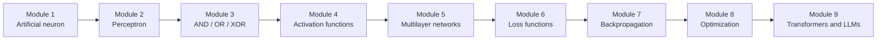

# Neuron to Neural Networks

**From a single artificial neuron to modern neural networks: the mathematics of learning, architecture, and limitations.**

[Learning roadmap](docs/learning_roadmap.md) · [Experiment results](reports/experiment_results.md) · [Contributing](CONTRIBUTING.md) · [License](LICENSE)

---

## Table of contents

1. [Overview](#overview)
2. [Research motivation](#research-motivation)
3. [Learning objectives](#learning-objectives)
4. [Main research question](#main-research-question)
5. [Repository structure](#repository-structure)
6. [Learning roadmap](#learning-roadmap)
7. [Mathematical topics](#mathematical-topics)
8. [Technology stack](#technology-stack)
9. [Installation](#installation)
10. [Running the notebooks and experiments](#running-the-notebooks-and-experiments)
11. [Experiments](#experiments)
12. [Expected learning outcomes](#expected-learning-outcomes)
13. [Development status](#development-status)
14. [Future research directions](#future-research-directions)
15. [References](#references)
16. [License](#license)

---

## Overview

This repository explains how neural networks work from first principles. It starts with one artificial neuron, computes its output by hand and in code, trains a perceptron on AND, OR and XOR, and then builds toward multilayer networks, backpropagation, optimizers, and Transformers.

The guiding rule is that formulas are never shown in isolation. Every equation is connected to the step that uses it and to its effect on the whole network.

## Research motivation

Most introductions to deep learning start with a framework call and never explain what the framework computes. This project asks a narrower question first: **what can one neuron compute, and what exactly breaks when it cannot?** The answer to the XOR case is the starting point for the rest of the mathematics: depth, nonlinearity, gradients, and optimization.

## Learning objectives

By working through the repository, a reader should be able to:

1. Compute the output of an artificial neuron by hand and in NumPy.
2. Explain the perceptron learning rule and what each term does.
3. Reproduce the AND, OR, and XOR experiments and explain the XOR failure with a proof.
4. Write the forward pass of a dense network as matrix operations, and track shapes.
5. Derive the gradients of a small network with the chain rule and check them numerically.
6. Relate these foundations to attention, residual connections, and normalization in Transformers.

## Main research question

> **Can one neuron learn AND and OR, and why does it fail on XOR?**

The question is answered in [`experiments/logic_gates.py`](experiments/logic_gates.py) and the proof in the [learning roadmap](docs/learning_roadmap.md#module-3-and-or-xor).

## Repository structure

Status key: **Implemented** means the code runs and is tested. **Planned** means the folder or file is not yet written.

```
neuron-to-neural-networks/
├── README.md                     Implemented
├── LICENSE                       Implemented (MIT)
├── CONTRIBUTING.md               Implemented
├── requirements.txt              Implemented
├── .gitignore                    Implemented
├── docs/
│   └── learning_roadmap.md       Implemented
├── notebooks/                    Planned (10 notebooks; see roadmap)
├── src/
│   └── perceptron.py             Implemented (tested)
├── tests/
│   └── test_perceptron.py        Implemented (6 tests)
├── experiments/
│   └── logic_gates.py            Implemented (AND, OR, XOR)
├── results/
│   └── logic_gates.json          Generated by the experiment
├── assets/
│   └── plots/logic_gates.png     Generated by the experiment
└── reports/
    └── experiment_results.md     Generated by the experiment
```

Only the folders marked "Implemented" contain verified material. The other folders are planned.

## Learning roadmap



The full roadmap, with the status of each module, is in [`docs/learning_roadmap.md`](docs/learning_roadmap.md).

## Mathematical topics

- Weighted sums, dot products, and matrix multiplication
- Step, sigmoid, tanh, ReLU, Leaky ReLU, and softmax
- Linear separability and decision boundaries
- Cross-entropy and mean squared error
- Derivatives, partial derivatives, the chain rule, and gradients
- Gradient descent, momentum, RMSProp, and Adam
- Attention, residual connections, and layer normalization

## Technology stack

- Python 3
- NumPy for all core calculations
- Matplotlib for figures
- Jupyter for notebooks
- Standard library `unittest` for tests

No deep-learning framework (PyTorch, TensorFlow) or machine-learning library (scikit-learn) is used to hide the calculations.

## Installation

Requires Python 3.9 or newer.

```bash
git clone <repository-url> neuron-to-neural-networks
cd neuron-to-neural-networks
python -m venv .venv
.venv\Scripts\activate            # Windows
# source .venv/bin/activate       # macOS / Linux
pip install -r requirements.txt
```

## Running the notebooks and experiments

Run the tests:

```bash
python -m unittest discover -s tests -v
```

Run the logic-gate experiment (writes results, a report, and a figure):

```bash
python experiments/logic_gates.py
```

Launch Jupyter for the notebooks:

```bash
jupyter notebook notebooks/
```

The notebooks are planned. The first working notebook (`01_neuron.ipynb`) is the original exercise from the lab folder and is not yet copied here.

## Experiments

| Experiment | Status | Output |
|---|---|---|
| AND gate | Implemented | [reports/experiment_results.md](reports/experiment_results.md) |
| OR gate | Implemented | same report |
| XOR gate | Implemented | same report, with the proof in the roadmap |
| Multilayer network | Planned | none yet |

Results are generated by the script, not typed by hand. Re-running the script with the same settings reproduces them.

## Expected learning outcomes

After the implemented material, a reader should be able to explain why AND and OR are learnable, why XOR is not, and what the mistake count per epoch shows. The planned modules extend this to gradients and Transformers.

## Development status

| Area | Status |
|---|---|
| Perceptron implementation and tests | Implemented |
| AND / OR / XOR experiment | Implemented |
| Learning roadmap and proof | Implemented |
| Notebooks 01–10 | Planned |
| Multilayer network, backpropagation, optimizers | Planned |
| Transformer modules | Planned |

## Future research directions

- Gradient checking for a two-layer network, with hand-derived gradients.
- Comparing SGD, momentum, RMSProp, and Adam on a fixed problem with held-out data.
- Controlled experiments on activation functions with matched initialization.
- Attention on a small sequence, with the causal mask and the KV cache.

These are not claims about results. They are directions for future work.

## References

- Rosenblatt, F. (1958). The perceptron: A probabilistic model for information storage and organization in the brain. *Psychological Review*, 65(6), 386–408.
- Minsky, M., & Papert, S. (1969). *Perceptrons: An Introduction to Computational Geometry*. MIT Press.
- Rumelhart, D. E., Hinton, G. E., & Williams, R. J. (1986). Learning representations by back-propagating errors. *Nature*, 323, 533–536.
- Goodfellow, I., Bengio, Y., & Courville, A. (2016). *Deep Learning*. MIT Press.
- Vaswani, A., et al. (2017). Attention is all you need. *Advances in Neural Information Processing Systems*.

A fuller list is planned in `docs/references.md`.

## License

This project is licensed under the MIT License. See [LICENSE](LICENSE).
