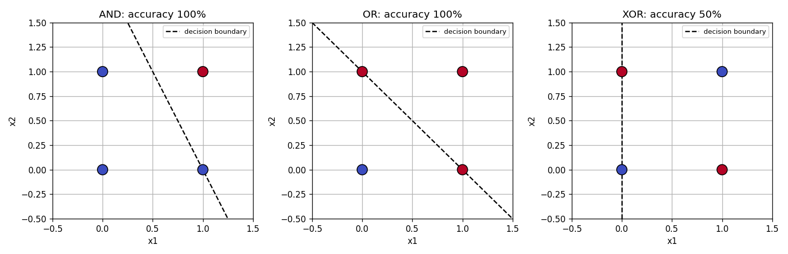

# Neuron to Neural Networks

**From a single artificial neuron to modern neural networks: the mathematics of learning, architecture, and limitations.**



### Results at a glance

- **AND and OR:** one perceptron reaches 100% accuracy with 0 mistakes after epoch 4.
- **XOR:** one perceptron never reaches 0 mistakes (50% accuracy). A proof shows no straight line separates XOR.
- **Adding a hidden layer:** two hidden units solve XOR in 16 of 20 random starts, and three or four units in 20 of 20.

[Learning roadmap](docs/learning_roadmap.md) · [Experiment design](docs/experiment_design.md) · [Mathematical analysis](reports/mathematical_analysis.md) · [Contributing](CONTRIBUTING.md) · [License](LICENSE)

---

## Table of contents

1. [Overview](#overview)
2. [Research motivation](#research-motivation)
3. [Learning objectives](#learning-objectives)
4. [Main research question](#main-research-question)
5. [Repository structure](#repository-structure)
6. [Learning roadmap](#learning-roadmap)
7. [Mathematical topics](#mathematical-topics)
8. [Technology stack](#technology-stack)
9. [Installation](#installation)
10. [Running the notebooks and experiments](#running-the-notebooks-and-experiments)
11. [Experiments](#experiments)
12. [Expected learning outcomes](#expected-learning-outcomes)
13. [Development status](#development-status)
14. [Future research directions](#future-research-directions)
15. [References](#references)
16. [License](#license)

---

## Overview

This repository explains how neural networks work from first principles. It starts with one artificial neuron, computes its output by hand and in code, trains a perceptron on AND, OR and XOR, and then covers activations, losses, forward and backward passes, optimizers, a multilayer network, and a Transformer block.

Every formula is shown with the step that uses it and its effect on the whole network. Every number reported here comes from a script in this repository.

## Research motivation

Most introductions to deep learning start with a framework call and never explain what the framework computes. This project asks a narrower question first: **what can one neuron compute, and what exactly breaks when it cannot?** The answer to the XOR case is the starting point for depth, nonlinearity, gradients, and optimization.

## Learning objectives

By working through the repository, a reader should be able to:

1. Compute the output of an artificial neuron by hand and in NumPy.
2. Explain the perceptron learning rule and what each term does.
3. Reproduce the AND, OR, and XOR experiments and explain the XOR failure with a proof.
4. Write the forward pass of a dense network as matrix operations, and track shapes.
5. Derive the gradients of a small network with the chain rule and check them numerically.
6. Design a controlled experiment with held-out data and a stated decision rule.
7. Relate these foundations to attention, residual connections, and normalization in Transformers.

## Main research question

> **Can one neuron learn AND and OR, and why does it fail on XOR?**

The question is answered in [`experiments/logic_gates.py`](experiments/logic_gates.py), the proof is in the [learning roadmap](docs/learning_roadmap.md#module-3-and-or-xor), and a hidden layer that solves XOR is tested in [`experiments/multilayer_network/run.py`](experiments/multilayer_network/run.py).

## Repository structure

Status key: **Implemented** means the file exists and is tested or executed. The layout deviates from the original plan in two places, explained in [docs/project_overview.md](docs/project_overview.md#design-decisions).

```
neuron-to-neural-networks/
├── README.md                          Implemented
├── LICENSE                            Implemented (MIT)
├── CONTRIBUTING.md                    Implemented
├── requirements.txt                   Implemented
├── .gitignore                         Implemented
├── docs/
│   ├── project_overview.md            Implemented
│   ├── learning_roadmap.md            Implemented
│   ├── mathematical_prerequisites.md  Implemented
│   ├── concept_relationship_map.md    Implemented (Mermaid)
│   ├── experiment_design.md           Implemented
│   └── references.md                  Implemented (checked; some venues flagged)
├── notebooks/
│   ├── 01_artificial_neuron.ipynb                  Implemented (executed)
│   ├── 02_perceptron_and_linear_separability.ipynb Implemented (executed)
│   ├── 03_and_or_xor_experiments.ipynb             Implemented (executed)
│   ├── 04_activation_functions.ipynb               Implemented (executed)
│   ├── 05_forward_propagation.ipynb                Implemented (executed)
│   ├── 06_loss_functions.ipynb                     Implemented (executed)
│   ├── 07_gradient_descent.ipynb                   Implemented (executed)
│   ├── 08_backpropagation.ipynb                    Implemented (executed)
│   ├── 09_multilayer_network.ipynb                 Implemented (executed)
│   ├── 10_neural_network_experiments.ipynb         Implemented (executed)
│   └── 11_attention_and_transformer_block.ipynb    Implemented (executed; beyond the 10-notebook plan)
├── src/
│   ├── perceptron.py                  Implemented (tested)
│   ├── activations.py                 Implemented (tested)
│   ├── losses.py                      Implemented (tested)
│   ├── mlp.py                         Implemented (tested; two-layer network, batch training)
│   ├── optimizers.py                  Implemented (tested)
│   └── transformer.py                 Implemented (tested)
├── tests/
│   ├── test_perceptron.py             Implemented
│   ├── test_activations_losses.py     Implemented
│   ├── test_mlp.py                    Implemented (gradient check vs finite differences)
│   ├── test_multilayer_batch.py       Implemented (matrix vs loop form; XOR training)
│   ├── test_optimizers.py             Implemented
│   └── test_transformer.py            Implemented
├── experiments/
│   ├── logic_gates.py                 Implemented (AND, OR, XOR)
│   ├── multilayer_network/run.py      Implemented (XOR across widths and seeds)
│   └── learning_rate_study/run.py     Implemented (held-out validation)
├── results/                           Generated by the experiment scripts
├── assets/
│   └── plots/                         Generated by the experiment scripts
└── reports/
    ├── experiment_results.md          Generated
    ├── multilayer_results.md          Generated
    ├── learning_rate_study.md         Generated
    └── mathematical_analysis.md       Written, cites the generated results
```

## Learning roadmap


The full roadmap, with the status of each module, is in [`docs/learning_roadmap.md`](docs/learning_roadmap.md).

## Mathematical topics

- Weighted sums, dot products, and matrix multiplication
- Step, sigmoid, tanh, ReLU, Leaky ReLU, and softmax
- Linear separability, decision boundaries, and the XOR proof
- Mean squared error, binary and categorical cross-entropy
- Derivatives, partial derivatives, the chain rule, gradients, and backpropagation
- Gradient descent, momentum, RMSProp, and Adam
- Attention, causal masking, residual connections, and layer normalization

## Technology stack

- Python 3
- NumPy for all core calculations
- Matplotlib for figures
- Jupyter for notebooks
- Standard library `unittest` for tests

No deep-learning framework (PyTorch, TensorFlow) or machine-learning library (scikit-learn) is used to hide the calculations.

## Installation

Requires Python 3.9 or newer.

```bash
git clone https://github.com/Marinnex-Lab/neuron-to-neural-networks.git
cd neuron-to-neural-networks
python -m venv .venv
.venv\Scripts\activate            # Windows
# source .venv/bin/activate       # macOS / Linux
pip install -r requirements.txt
```

## Running the notebooks and experiments

Run the tests (48 tests):

```bash
python -m unittest discover -s tests -v
```

Run the experiments. Each writes its results to `results/`, its report to `reports/`, and its figure to `assets/plots/`:

```bash
python experiments/logic_gates.py                     # about 1 second
python experiments/learning_rate_study/run.py         # about 20 seconds
python experiments/multilayer_network/run.py          # about 2 minutes
```

Launch Jupyter for the notebooks:

```bash
jupyter notebook notebooks/
```

Notebooks 01–11 are saved with their outputs from a top-to-bottom run.

## Experiments

| Experiment | Question | Result file |
|---|---|---|
| Logic gates | Can one perceptron learn AND, OR, XOR? | [reports/experiment_results.md](reports/experiment_results.md) |
| Multilayer XOR | How often does a hidden layer solve XOR across seeds and widths? | [reports/multilayer_results.md](reports/multilayer_results.md) |
| Learning rate | Which learning rate gives the lowest validation loss, under a fixed budget? | [reports/learning_rate_study.md](reports/learning_rate_study.md) |

Each experiment is designed before it is run. See [docs/experiment_design.md](docs/experiment_design.md) for the template and the decision rules.

Key findings, with their limits:

- **Logic gates:** AND and OR reach 0 mistakes; XOR never does.
- **Multilayer XOR:** two hidden units solved XOR in 16 of 20 seeds; three and four units in 20 of 20. These are results for XOR only.
- **Learning rate:** the smallest rate had not converged after 1500 steps, so its comparison partly measures speed. The rule chose 2.0.

## Expected learning outcomes

After the implemented material, a reader should be able to explain why AND and OR are learnable, why XOR is not, how a hidden layer changes that, how gradients are computed and checked, how optimizers differ, and how attention and residual blocks are built.

## Development status

| Area | Status |
|---|---|
| Perceptron, activations, losses, optimizers, two-layer network, Transformer block | Implemented, 48 tests passing |
| Notebooks 01–11 | Implemented, executed without errors |
| Experiments (logic gates, multilayer XOR, learning rate) | Implemented, results generated by scripts |
| Documentation (overview, roadmap, prerequisites, concept map, experiment design, references, analysis) | Implemented |
| Deep (many-layer) training, convolutional and recurrent networks | Not implemented |
| Benchmarks on real datasets | Not implemented |

## Future research directions

- Gradient checks and training for networks deeper than two layers.
- Comparing SGD, momentum, RMSProp, and Adam on a fixed problem with held-out data, using the experiment design in `docs/experiment_design.md`.
- Controlled experiments on activation functions with matched initialization.
- Attention on longer sequences, with timing and memory measurements.

These are not claims about results. They are directions for future work.

## References

Full list with checked details and notes in [docs/references.md](docs/references.md). Key sources:

- Rosenblatt, F. (1958). The perceptron: A probabilistic model for information storage and organization in the brain. *Psychological Review*, 65(6), 386–408. DOI: [10.1037/h0042519](https://doi.org/10.1037/h0042519)
- Minsky, M., & Papert, S. (1969). *Perceptrons: An Introduction to Computational Geometry*. MIT Press.
- Rumelhart, D. E., Hinton, G. E., & Williams, R. J. (1986). Learning representations by back-propagating errors. *Nature*, 323, 533–536. DOI: [10.1038/323533a0](https://doi.org/10.1038/323533a0)
- LeCun, Y., Bengio, Y., & Hinton, G. (2015). Deep learning. *Nature*, 521, 436–444. DOI: [10.1038/nature14539](https://doi.org/10.1038/nature14539)
- Cybenko, G. (1989). Approximation by superpositions of a sigmoidal function. *Mathematics of Control, Signals and Systems*, 2(4), 303–314. DOI: [10.1007/BF02551274](https://doi.org/10.1007/BF02551274)
- Kingma, D. P., & Ba, J. (2015). Adam: A method for stochastic optimization. *ICLR*. arXiv: [1412.6980](https://arxiv.org/abs/1412.6980)
- Vaswani, A., et al. (2017). Attention is all you need. *Advances in Neural Information Processing Systems 30*. arXiv: [1706.03762](https://arxiv.org/abs/1706.03762)

Each entry was checked against bibliographic records during the final review. Where a venue could not be confirmed (Novikoff 1962, He et al. 2015, Ioffe & Szegedy 2015), `docs/references.md` says so. Confirm the details before a formal citation.

## License

This project is licensed under the MIT License. Copyright (c) 2026 Marinnex Lab. See [LICENSE](LICENSE).
